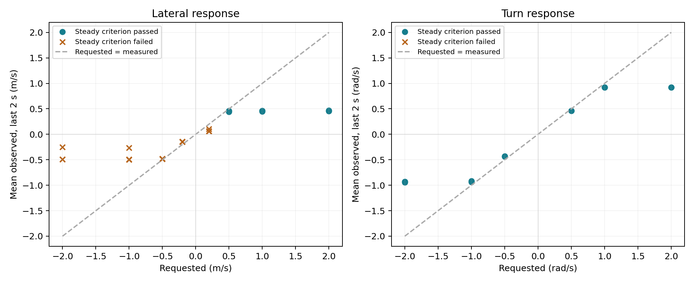
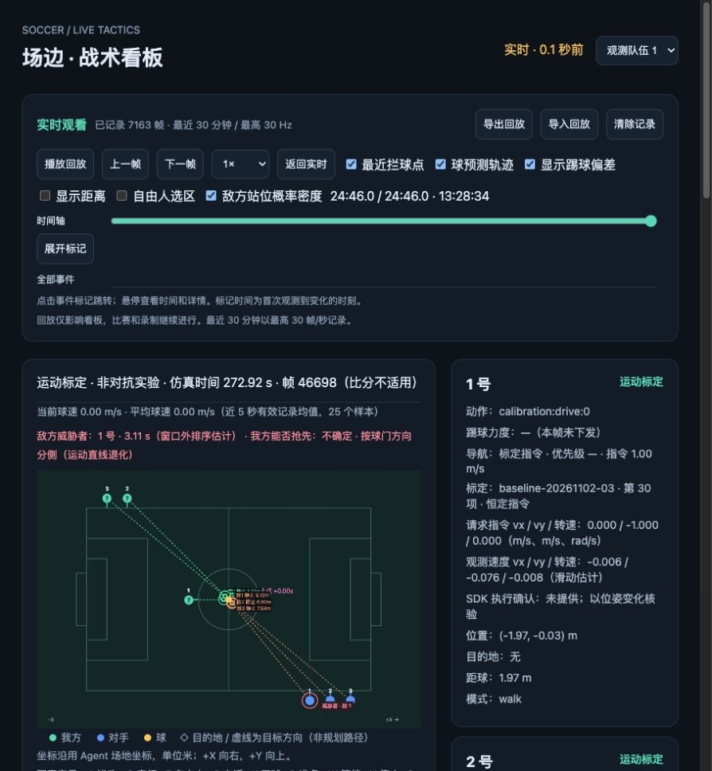

# 横移与转向实测标定

本报告仅提出参数建议，不修改生产策略参数。数据来自本机 K1 足球仿真，不能直接外推到真机或其他版本。

## 实验身份与方法

- 工作区：`/Users/limingzhe/.codex/worktrees/field-boundary-fix/sim-3v3-simple-framework`；分支 `codex/motion-calibration`；开发基线 `3133217399c9335c59d023d2a3dce66b1f2287fb`。
- 独立入口 `MotionCalibrationAgent`，生产 `agent.toml` 已恢复。`src/param.py` 未改动。构建包与部署的 47 个 Python 文件摘要核验见 `motion-calibration-evidence/identity.json`。
- Studio 1.110.1，boosteros 1.2.1，机器人 SDK 1.6.3；环境摘要见 `motion-calibration-evidence/environment.json`。仅选择 robot1，其他球员停止；不启动对抗比赛。基线及组合项目先归位，再预停 2 秒、恒定驱动 6 秒、停车观察 2 秒；反向项目驱动为两个方向各 4 秒。全部时间使用仿真观测时间。
- 横移 ±0.2/0.5/1/2 m/s，转向 ±0.5/1/2 rad/s，各三次；随后六项反向和六项组合验证。完整协议及稳定性门槛见 [标定说明](motion-calibration.md)。
- SDK 文档规定：身体坐标 x 向前、y 向左；绕 z 逆时针为正，单位 m/s 和 rad/s。SDK 将请求传给 `loco_client.Move`；本实验没有执行确认字段，因此请求值与观测响应分别记录。
- 位移按每个观测间隔的中点朝向投影，角度展开后以约 0.3 秒窗口回归速度。尾部 2 秒的均值用于描述，稳态与重复性是否通过单独报告。平滑速度的起步时间包含滤波延迟，不能作为纯通信延迟。

## 基线实测结果

42 项驱动全部完成，每个档位三次。下表数值是每次驱动末端 2 秒的平均速度；“稳态通过数”沿用预先确定的门槛，不能因曲线外观而改判。相对标准差 CV 表示三次均值之间的变异，不是单次步态内的波动。

| 轴 | 请求值 | 三次实测均值 | 重复间 CV | 稳态通过 | 综合资格 |
| --- | ---: | --- | ---: | ---: | --- |
| 横移 m/s | -2.0 | -0.491 / -0.252 / -0.493 | 27.4% | 0/3 | 未通过 |
| 横移 m/s | -1.0 | -0.490 / -0.266 / -0.497 | 25.7% | 0/3 | 未通过 |
| 横移 m/s | -0.5 | -0.483 / -0.485 / -0.481 | 0.3% | 0/3 | 未通过 |
| 横移 m/s | -0.2 | -0.145 / -0.152 / -0.148 | 1.9% | 0/3 | 未通过 |
| 转向 rad/s | -2.0 | -0.927 / -0.929 / -0.941 | 0.7% | 3/3 | 通过 |
| 转向 rad/s | -1.0 | -0.929 / -0.919 / -0.938 | 0.8% | 3/3 | 通过 |
| 转向 rad/s | -0.5 | -0.440 / -0.431 / -0.440 | 0.9% | 3/3 | 通过 |
| 转向 rad/s | +0.5 | +0.462 / +0.462 / +0.460 | 0.2% | 3/3 | 通过 |
| 转向 rad/s | +1.0 | +0.924 / +0.921 / +0.922 | 0.2% | 3/3 | 通过 |
| 转向 rad/s | +2.0 | +0.925 / +0.920 / +0.922 | 0.2% | 3/3 | 通过 |
| 横移 m/s | +0.2 | +0.058 / +0.062 / +0.104 | 27.5% | 0/3 | 未通过 |
| 横移 m/s | +0.5 | +0.445 / +0.462 / +0.457 | 1.6% | 3/3 | 通过 |
| 横移 m/s | +1.0 | +0.464 / +0.461 / +0.448 | 1.5% | 3/3 | 通过 |
| 横移 m/s | +2.0 | +0.463 / +0.457 / +0.467 | 0.9% | 3/3 | 通过 |

负向 0.5 m/s 指令的三次均值非常接近，但单次短窗口速度波动超过门槛，故仍未认证为稳态能力。负向 1/2 m/s 指令还出现明显重复间变化；正向 0.2 m/s 的低速响应同样不稳定。



### 动态响应

- 横移通过稳态项目的 t90：中位数 0.906 s，范围 0.812–1.304 s；包含约 0.3 s 速度估计窗口影响。
- 转向通过稳态项目的 t90：中位数 0.549 s，范围 0.354–0.592 s；包含约 0.3 s 速度估计窗口影响。
- 正向横移请求 0.5 m/s 后，停止段约 2 s 内净位移 0.236–0.284 m。这是观测窗口内净位移，不能等同完整制动路程或制动完成时间。
- 正向横移请求 1 m/s 后，停止段约 2 s 内净位移 0.453–0.473 m。这是观测窗口内净位移，不能等同完整制动路程或制动完成时间。
- 正向横移请求 2 m/s 后，停止段约 2 s 内净位移 0.465–0.504 m。这是观测窗口内净位移，不能等同完整制动路程或制动完成时间。

## 执行异常与数据保留

1. 第一版调度器在第 1 项后错误地标记整个序列完成。保留该项原始数据，修复序列状态后从第 2 项续测；增加逐项推进与完整 42 项调度回归测试。v1 与 v2 的身份分别保存，没有重复有利样本。
2. 第 2 段完成第 17 项后，第 18 项归位超时。连续请求横移时观测位姿几乎静止；反馈为 WALK、未跌倒、未处罚，未发现速度下发异常。日志中的 B1 服务等待警告从运行开始已存在，不能据此断言根因。保留异常归位与第 17 项的降速数据。
3. 通过官方仿真重置恢复后，从尚未驱动的第 18 项续测。新仿真时钟单独存档，分析不跨时钟重置求导，不把两段当作完全同条件的连续实验。异常样本不从统计中静默删除。

4. 验证阶段首项尚未驱动时，归位停在约 0.099 rad：标定门槛 0.08 rad 与普通导航约 0.1 rad 的到位转向死区冲突。保存未驱动记录并主动停用；仅在标定入口增加近点朝向校正，补充边界回归测试，从验证第 1 项继续。基线模型不重算，v2/v3 构建身份分别留存。

5. 验证完成前三项后，第 4 项归位在距目标约 0.16 m 处停滞，小幅后退请求未形成可见推进，最终归位超时。保留已完成三项及异常段；仅把标定近点归位改为 0.4 s 移动、1.6 s 停车观察的短脉冲，位置/朝向门槛与驱动协议不变，从未驱动的第 4 项继续。

6. 第 10 项归位再次超时，距目标约 0.21 m；短前进脉冲未完成归位。保留已完成的第 4–9 项与异常段，标定近点前后轴改为维持 ±0.5 m/s 请求至位置达标，横移仍使用脉冲；未更改验收门槛或测量段。从未驱动的第 10 项继续。

## 测试

- 控制与导航专项：38 项通过。
- 完整 Python 发现：114 项，113 项通过，1 个导入错误。缺少 `checks.goalkeeper_replay_cases`；对开发前基线执行同入口也复现该错误（105 项中 104 项通过）。不将其计作通过。
- 看板标定卡片、旧数据兼容、守门卡片检查及 JavaScript 语法检查通过。已在本机预览标定阶段、请求指令与观测速度。

## 比赛类分析的适用性

- 比分：本次没有对抗开赛；界面的 4:5 是实验前已自然结束的历史比赛，不能算作标定结果。标定时裁判状态保持 FINISHED，实际时长取机器人观测时间。
- 行为复现：原始记录含 run_id、trial、phase、sim_time、位姿、请求、模式和异常保护；可逐项在原始回放核查。
- 失分原因：无本次比赛、无本次失分事件，不作归因。
- 未得分原因：实验不包含进攻与射门，不能评估进攻转化率。

## 留出验证结果

验证幅度在基线冻结后确定：横移 ±0.5 m/s，转向 ±1 rad/s，前进分量 0.5 m/s。基线文件 SHA256 在全部修复和续测后仍保持一致。组合各方向仅一次，以下是完整驱动尾段 2 秒均值，不代表统计认证。

| 指令 vx / vy / 转速 | 实测横移 | 实测转速 | 对单轴预测的差异 |
| --- | ---: | ---: | --- |
| +0.5 / +0.5 / +0.0 | +0.147 m/s | 未激励 | 横移绝对幅度变化 -67.9% |
| +0.5 / -0.5 / -0.0 | -0.166 m/s | 未激励 | 横移绝对幅度变化 -65.7% |
| +0.5 / +0.0 / +1.0 | 未激励 | +0.926 rad/s | 转速绝对幅度变化 +0.5% |
| +0.5 / -0.0 / -1.0 | 未激励 | -0.947 rad/s | 转速绝对幅度变化 +1.9% |
| +0.0 / +0.5 / +1.0 | +0.213 m/s | +0.721 rad/s | 横移绝对幅度变化 -53.3%；转速绝对幅度变化 -21.8% |
| +0.0 / -0.5 / -1.0 | -0.433 m/s | -0.796 rad/s | 横移绝对幅度变化 -10.5%；转速绝对幅度变化 -14.3% |

前进加转向的两个方向通过了测量段稳态门槛；含横移的四项组合未通过，尾段均值用于描述耦合与波动，不作为已认证组合速度。负向横移基线本身未取得综合资格，因此相应误差仅为探索性比较。

反向指令后持续出现新方向速度的等待：横移 **0.808–0.924 s**，转向 **0.660–0.724 s**；角速度反向后的 t90 为 **1.064–1.202 s**。这些值包含约 0.3 s 拟合窗口影响。

本次结果支持两点：斜向行走显著降低可用横移分量；横移同时转向会降低角速度且呈方向差异。它们可造成基于单轴恒速模型的到达时间偏差，但尚不能独立归因某一场比赛中的绕圈行为。

## 参数建议的边界

本次区分“SDK 请求指令”和“规划能力估计”。以下建议仅供下一轮改动评审，没有写入 `src/param.py`：

- 转向能力：`GUARD_TURN_SPEED` / `NAV_TURN_SPEED_RPS` 可将 **0.90 rad/s** 作为单独转向的候选估计；实测平台约 0.92–0.94 rad/s。不能用指令上限 `MAX_ANGULAR=2` 表示实际转速。
- 横移指令：优先评估独立的 **±0.5 m/s 横移请求上限**。它已接近高档指令的实际速度，同时停止净位移更小。不要为此直接把全局 `MAX_LINEAR` 改为 0.5，因为前进与后退未在本任务中单轴标定。
- 横移能力：正向单独横移的 **0.45 m/s** 可作为候选标称值；负向 0.5 请求的平均速度约 0.48 m/s，但短窗口波动未过预定门槛。高档负向出现 0.25–0.50 m/s 的跨次变化，当前不能认证一个适用于全部指令和状态的双向常数。
- 小指令：±0.2 请求明显不符合“指令等于实际速度”，不建议仅用线性比例缩放解释近点低速行为。
- 动态预算：现有 `NAV_REACTION_S=0.10` 与 `NAV_BRAKE_S=0.25` 不能因接口单位正确就视为已标定。平滑 t90 不是纯延迟；本轮停止段只观察约 2 秒，不能直接把某个净位移或 t90 填进制动时间。应先用完整停止/反向轨迹核验相应模型，再调整预算。
- 组合运动：本次前进加横移的横移均值只有 **0.15–0.17 m/s**，横移加转向的角速度约 **0.72–0.80 rad/s**；这些是条件限定的单次验证值，暂不建议直接填入全局常数。后续模型需区分纯横移、斜向移动和横移转向，采用不同响应估计。

## 数据位置与复现

原始数据、回放、分析与构建身份在 `docs/motion-calibration-evidence/`。回放使用 `soccer-tactics-replay` v1，无损 gzip 压缩；解压后可导入战术看板。共享看板历史未清空。

```sh
python3 tools/motion_calibration/analyze.py RAW.jsonl.gz --output analysis.json
python3 tools/motion_calibration/aggregate.py RAW_1.jsonl.gz RAW_2.jsonl.gz --output combined.json
python3 tools/motion_calibration/plot.py RAW_1.jsonl.gz RAW_2.jsonl.gz --output figures
```

## 完成状态与采集范围

54 项计划驱动全部执行：42 项基线、6 项反向、6 项组合，共 60 个驱动段。标称固定协议 552 s，其中驱动 336 s；离散采样端点覆盖的驱动跨度合计 **335.154 s**。七段原始记录的仿真时间跨度合计 **1254.206 s**，包含归位与失败段，不包括段间未记录等待，不冒充连续比赛时间。

共 **83,441 条**原始记录，**67,832 帧**看板回放，回放 gzip 合计 **81,337,086 字节**。各段帧编号无缺口；原始观测最大间隔为 0.064 s。完整范围、大小与校验和见 [数据清单](motion-calibration-evidence/data-summary.json)。

| 原始段 | 仿真时间范围（s） | 原始记录 |
| --- | ---: | ---: |
| baseline-20261102-01 | 20.742–53.592 | 1854 |
| baseline-20261102-02 | 128.128–501.978 | 22164 |
| baseline-20261102-03 | 16.650–516.878 | 33679 |
| validation-20261102-01 | 537.026–576.468 | 3165 |
| validation-20261102-02 | 598.664–701.692 | 6155 |
| validation-20261102-03 | 743.726–904.096 | 12586 |
| validation-20261102-04 | 952.722–997.160 | 3838 |

实验代理已通过官方入口停止，启用文件已移除；临时 8766 预览服务已关闭，共享 8765 看板与历史保留。正式 agent.toml 入口已恢复，src/param.py SHA256 与实验前一致。当前部署的实验包已停止，未声称已重新部署生产代理。

已知限制：仅 K1 robot1、单一场景；随机种子未控制；没有 SDK 执行确认；归位程序经过修复、一次仿真重置，属于分段续测；v1 包仅保留当时摘要，没有单独归档。失败记录全部保留，已执行的驱动没有补跑或筛除。单轴转向和部分正向横移通过门槛，其余响应不能全部称为合格标定。


